# NodeSet.js user manual

NodeSet.js is a graphical modeler for OPC UA information models. It draws
types and instances in the notation of OPC 10000-3 Annex C and reads and
writes NodeSet2 files. This manual is for people who model with it: it
assumes a rough knowledge of OPC UA, not of the modeler's code.

The chapters follow one example, a model `http://example.org/Pump/` with a
`PumpType`, its DataTypes, a state machine and an instance. The pictures are
taken from that model by `npm run manual:shots`.

## Contents

- [Getting started](#getting-started)
- [The screen](#the-screen)
- [Types](#types)
- [Instance declarations and ModellingRules](#instance-declarations-and-modellingrules)
- [Values](#values)
- [Methods and arguments](#methods-and-arguments)
- [References](#references)
- [State machines](#state-machines)
- [Instances](#instances)
- [Checks and findings](#checks-and-findings)
- [Undo and redo](#undo-and-redo)
- [Saving and what is kept](#saving-and-what-is-kept)
- [The backup of unsaved work](#the-backup-of-unsaved-work)
- [Language](#language)
- [Embedding](#embedding)
- [Limits](#limits)

## Getting started

### The page

The modeler is a web page. Where it is installed, open its address in the
browser. From a clone of the repository, `npm install` and `npm run dev`
serve it at http://localhost:3002.

At first the page is empty, and the status line at the bottom says: "Start a
new model, open a NodeSet2 file, or open the DI sample." These are the three
ways in.

### A new model

Click **New model…**. A field takes its place in the toolbar, filled with
`http://example.org/MyModel/`. Type the namespace URI of the new model and
click **Create**, or press Enter; **Cancel** or Escape leaves it.

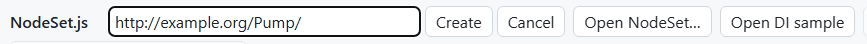

The new model has no nodes yet. It has the version 1.0.0, today's date as
its publication date, and requires the OPC UA base model. A text that is not
a URI is refused, and the status line says so ("'…' is not a URI.").

### Opening a NodeSet

**Open NodeSet…** opens a NodeSet2 file (`.xml`) for editing. The modeler
also loads the models the file requires. It ships two of them, the OPC UA
base model (1.05.07) and OPC UA for Devices (DI, 1.05.0); every other
required model has to come from a file. If one is missing, the status line
names it ("…: missing required models: …"). Load it with **Load a NodeSet
file…** in the [model panel](#the-model-panel).

The nodes of the opened file are the ones you edit. The nodes of the models
it requires are shown, read only.

### The DI sample

**Open DI sample** opens the DI NodeSet that ships with the modeler as the
model to edit. It is a model to look around in and to try things on;
changes stay in the page until you save them as a file of your own.

When the model has changes that are not saved, **Create**, **Open NodeSet…**
and **Open DI sample** first ask: "The model has changes that are not saved.
Discard them?"

## The screen


### The toolbar

From left to right: **New model…**, **Open NodeSet…**, **Open DI sample**,
**Save NodeSet** (with a star, **Save NodeSet \***, while there are unsaved
changes), **Undo**, **Redo**, **Reset layout** (while a diagram is shown),
**Model**, the **Checks** button, which counts the findings ("Checks: 1
error(s), 0 warning(s)"), and the checkbox **Types of required models**.
In a narrow window the toolbar takes two rows.

### The list on the left

The field **Filter types** narrows the list to the names that contain what
you type. The list has a group for each kind of type (ObjectTypes,
VariableTypes, DataTypes, ReferenceTypes), each with its count and a **+**
that adds a type of that kind; the ObjectTypes also have **+ machine**, which
adds a state machine type. Abstract types are set in italics.

At first the list shows the types of the model you edit. With **Types of
required models** checked, it also shows those of the loaded models, in
grey. The group Instances lists the model's Objects and Variables that the
Objects folder organizes or that hang below a node of a loaded model, such
as DI's DeviceSet, each with its type after `::`. What an instance holds is
not listed; it shows in that instance's diagram.

Click an entry, or select it with the keyboard and press Enter or Space: the
canvas shows its diagram and the panel on the right its properties.

### The canvas

The canvas shows one type at a time in the notation of OPC 10000-3 Annex C:
the type with its supertype above it, and below it the instance
declarations it holds, three levels deep and at most 200 shapes. When more
are left out, the status line says so. Declarations the type inherits are
not drawn; double-click the supertype to see its own. An instance selected
in the list is drawn the same way, with its children.

What the shapes and lines mean:

| Drawn as | Stands for |
|---|---|
| Rectangle | Object, ObjectType |
| Rectangle with round corners | Variable, VariableType |
| Ellipse | Method |
| Hexagon | DataType |
| Hexagon with a notch on the left | ReferenceType |
| Italic name with a shadow | a type |
| `::Name` below the name | the TypeDefinition of an Object or Variable |
| Grey fill | a node of another model, read only |
| One stroke across the line at the held node | HasComponent |
| Two strokes | HasProperty |
| `1`, `0..1`, `1..n`, `0..n` at the held node | the ModellingRule: Mandatory, Optional, MandatoryPlaceholder, OptionalPlaceholder |
| Two hollow arrow heads at the supertype | HasSubtype |
| Open arrow head and a name | another hierarchical reference, such as Organizes |
| Filled arrow head and a name, on a line to the right of the shapes | a non-hierarchical reference; a symmetric one has a head at both ends |

To move around, drag the empty canvas. The mouse wheel scrolls, with Shift
sideways; Ctrl and the wheel zoom (on a Mac also Cmd and the wheel).

Click a shape to select its node: the panel shows it, and for a node of your
model a small context pad appears beside the shape. Its entries:

| Entry | What it does |
|---|---|
| **V**, **P**, **O**, **M** | Add a variable (HasComponent), a property (HasProperty), an object (HasComponent) or a method (HasComponent) below the node, asking for its name; on ObjectTypes, VariableTypes, Objects and Variables |
| **→** | Draw a reference to another node (see [References](#references)) |
| **×** | Delete the node and what it holds |

Double-click a shape to open its type: a type shows its own diagram, an
Object or Variable the diagram of its TypeDefinition.

Drag shapes to place them where you want. The modeler keeps the positions
in the NodeSet when it is saved (see [Saving](#saving-and-what-is-kept)).
**Reset layout** forgets the positions of the diagram shown, so it is laid
out anew.

### The node editor

The panel on the right shows the selected node: its name and NodeClass at
the top, then its fields and sections. Which ones appear depends on the
NodeClass; the chapters below go through them. A node of another model says
"Part of `<namespace>`; read only." and cannot be changed.

A field takes its new text when you press Enter or leave the field; Escape
puts back the old text. Fields that name a type or a DataType (Supertype,
TypeDefinition, DataType) suggest names as you type; a name that exists in
several models carries its namespace in parentheses. A name that matches
nothing is dropped when you leave the field.

Some sections are edited as a whole: the arguments of a method, the fields
of a DataType and a structure value. Their changes wait until you click
**Apply**, and **Discard** drops them. Selecting another node, saving or
applying the model to a document while such changes wait asks first
("…: changes not applied yet. Drop them?"). Clicking the node you are on, or
a change that redraws the canvas, asks nothing. The panel of another node
starts afresh: nothing you typed or picked for one node reaches the next.

At the bottom, a type has **Show diagram**, and every node of your model has
**Delete**.

### The model panel

**Model** in the toolbar shows the model itself in the panel; so does the
panel when no node is selected.

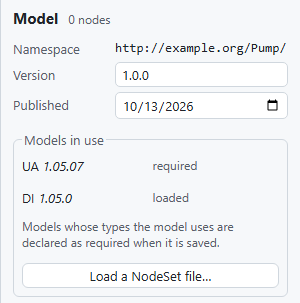

- **Namespace**: the namespace URI of the model, read only.
- **Version** and **Published**: the version and publication date the
  NodeSet declares for the model.
- **Models in use**: every loaded model with its version, marked
  "required" when the model declares it as a RequiredModel and "loaded"
  otherwise. **Load DI/** loads the DI model that ships with the modeler
  (the button is there while DI is neither loaded nor the model you edit).
  **Load a NodeSet file…** loads any other NodeSet, with the models it
  requires as far as the modeler has them. A file of models that are loaded
  already, or of the model you edit, adds nothing, and the status line says
  so. The types of a loaded model can then be used in yours.

### Dialogs, the status line and failures

A name for something new (a type, a child from the context pad, the
ReferenceType of a reference drawn on the canvas) is asked in a small
dialog: **OK** or Enter takes it, **Cancel**, Escape or a click beside the
dialog leaves it. An empty name is refused with "Enter a name."

The status line at the bottom reports what happened: a file read, a change
("Changed. Save to keep the NodeSet."), or why a change was refused. It
shows warnings in colour.

The page follows the light or dark setting of the system; the canvas stays
white in both.

If a part of the page fails while it is drawn, it says so in its place ("The
node editor stopped: …") with **Try again**. If the whole modeler fails, the
model is kept: the message offers **Save NodeSet** and **Try again**, which
starts the modeler anew with the same model.

## Types

Each group of the list has a **+** that adds a type of its kind; a dialog
asks for the name. A new type starts with this supertype:

| New | Supertype | Also |
|---|---|---|
| ObjectType | BaseObjectType | |
| VariableType | BaseDataVariableType | DataType BaseDataType, ValueRank Any |
| DataType | Structure | the encodings "Default Binary", "Default XML" and "Default JSON" |
| ReferenceType | NonHierarchicalReferences | InverseName "Inverse" and the name |

Every type has the fields **Name** (the BrowseName; the DisplayName follows
it), **NodeId** (assigned by the modeler), **Description**, **Supertype** and
**Abstract**. Type a supertype's name to change it; the modeler refuses one
that is a subtype of the type itself. An abstract type has no instances.

ObjectTypes and VariableTypes hold instance declarations, the subject of the
[next chapter](#instance-declarations-and-modellingrules). A state machine
type is an ObjectType of its own kind, see [State machines](#state-machines).

### DataTypes

What a DataType holds follows from its supertype. The panel shows a section
for it:

| Supertype | Section | One row per |
|---|---|---|
| Structure, or one of its subtypes (the default) | **Fields** | field: name, DataType, **Scalar** or **Array**, **optional**, **subtypes** |
| Union, or one of its subtypes | **Fields (exactly one is set)** | field: name, DataType, **Scalar** or **Array**, **subtypes** |
| Enumeration | **Values** | value: number and name |
| an unsigned integer (Byte, UInt16, UInt32, UInt64) or OptionSet | **Options (bit numbers)** | option: bit and name |
| any other (Int32, String …) | none | |

**+ Field**, **+ Value** or **+ Option** adds a row, **×** removes one, and
**Apply** writes them all as one step. The modeler refuses a row without a
name, two rows with the same name, two values or bits with the same number,
and a bit beyond the width of the integer (0 to 31 for UInt32, for
example).

For an enumeration, give it Enumeration as supertype, then add the values.
They are numbered 0, 1, 2 … as they are added; the numbers can be changed.
The modeler writes the EnumStrings property when the numbers run 0, 1, 2 …,
and EnumValues otherwise.

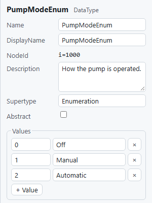

A structure keeps the supertype Structure. Each field has a name, a
DataType, **Scalar** or **Array**, and two checkboxes: **optional** lets a
value leave the field out (StructureWithOptionalFields), **subtypes** lets
the field hold a subtype of its DataType (AllowSubTypes). A union has no
optional fields; exactly one of its fields is set.

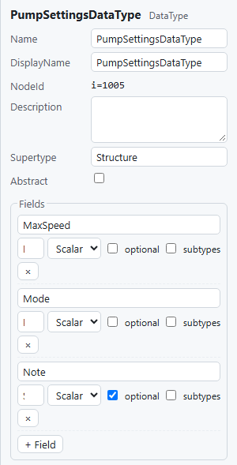

An OptionSet names its bits. The modeler writes the OptionSetValues
property for it.

A structure gets its three encodings when it is created; making it
abstract removes them, and making it concrete again adds them. When the
supertype changes, the rows carry over between structures and unions and
between enumerations and OptionSets; otherwise they are removed.

### ReferenceTypes

A ReferenceType has, besides the fields every type has, **Symmetric** and,
when it is not symmetric, **InverseName**. The supertype decides whether it
is hierarchical: NonHierarchicalReferences (the default) or one of its
subtypes makes it non-hierarchical, HierarchicalReferences or one of its
subtypes hierarchical. The example has a ReferenceType `Drives` with the
InverseName `IsDrivenBy`.

## Instance declarations and ModellingRules

The children of a type are its instance declarations: what every instance
of the type gets, as its ModellingRule says.

### Adding a child

The section **Add child** in the panel of an ObjectType or a VariableType
(and of an Object or Variable below one) adds a child:

1. Choose what it is: **Variable (HasComponent)**, **Property
   (HasProperty)**, **Object (HasComponent)** or **Method (HasComponent)**.
2. Choose its ModellingRule: **Mandatory (1)**, **Optional (0..1)**,
   **MandatoryPlaceholder (1..n)** or **OptionalPlaceholder (0..n)**.
3. Type its name and click **Add**, or press Enter.

The panel then shows the new child. The entries **V**, **P**, **O** and
**M** of the context pad on the canvas do the same with the ModellingRule
Mandatory. Two children of one node cannot have the same name.

A new Variable has the TypeDefinition BaseDataVariableType, a Property
PropertyType, an Object BaseObjectType. A Variable or Property starts with
the DataType BaseDataType and the ValueRank Scalar.

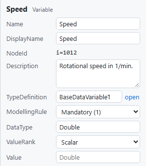

### The fields of a declaration

- **TypeDefinition**: the type of the Object or Variable. **open** beside
  it shows that type. To give `PumpType` a state machine, for example, add
  an Object and set its TypeDefinition to the machine type.
- **ModellingRule**: the four rules and **(none)**. The diagram shows the
  rule as the cardinality at the held node.
- **DataType**, **ValueRank** and **Value**: see [Values](#values).

A placeholder (MandatoryPlaceholder, OptionalPlaceholder) of an Object or
Variable is named in angle brackets, such as `<Pump>`; the checks warn when
the name and the rule do not agree.

### Variables from a CSV file

**Variables from CSV…** (in the panel of an ObjectType, a VariableType, an
Object or a Variable of your model) adds a list of variables at once, from a CSV file
with a header row. The separator may be a comma, a semicolon or a tab. The
columns, found by their header:

| Column | Content | If empty |
|---|---|---|
| Name | the name (required) | |
| DataType | the name of a DataType | BaseDataType |
| Kind | Variable or Property | Variable |
| ModellingRule | Mandatory or Optional | Mandatory |
| Description | a text | none |
| Value | the value, as typed in the panel | none |

```
Name;DataType;Kind;ModellingRule;Description;Value
Pressure;Double;Variable;Mandatory;Outlet pressure in bar;0
Manufacturer;String;Property;Optional;;
```

The file is added as one step, which one **Undo** takes back. A row the
modeler cannot take stops the whole file, and the status line names its
line.

### Renaming and deleting

**Name** renames the node; its DisplayName follows. **Delete** in the panel,
or **×** in the context pad, deletes the node, everything it holds and every
reference to them. A type that has subtypes is not deleted: "'…' has
subtypes; delete or move them first." Nor is a DataType that a variable, an
argument or a field still names: "'StatusType' is the DataType of 'Speed';
give it another DataType first." A new node never gets the NodeId of a node
deleted in the same session.

## Values

Variables and VariableTypes have the fields **DataType**, **ValueRank** and
**Value**. A value on a declaration is the value every new instance gets.

### Scalars and arrays

Type the value into **Value** and press Enter; empty text removes the value.
The field says in grey what it expects: the built-in type, `a; b; c` for an
array, or `a; b | c; d (rows separated by |)` for a matrix. The DataType
decides how the text is read; a DataType derived from a built-in type is
read as that type, an enumeration as Int32:

| Built-in type | Text |
|---|---|
| Boolean | `true` or `false` |
| SByte, Byte, Int16, UInt16, Int32, UInt32, Int64, UInt64 | an integer within the range of the type |
| Float, Double | a number |
| DateTime | a date and time, such as `2026-09-27T10:00:00Z`; stored in UTC |
| Guid | `xxxxxxxx-xxxx-xxxx-xxxx-xxxxxxxxxxxx` in hexadecimal digits |
| ByteString | Base64 |
| String, LocalizedText | any text |

A text that does not fit is refused, and the status line says why ("'yes'
is not true or false."). Values of the other built-in types, such as NodeId,
QualifiedName or StatusCode, are not edited in the panel.

**ValueRank** offers ScalarOrOneDimension, Any, Scalar, OneOrMoreDimensions,
OneDimension and TwoDimensions. With OneDimension or OneOrMoreDimensions the
value is an array: its elements separated by semicolons, `1; 2; 3`. With the
other ranks except TwoDimensions it is a single value.

Changing the DataType or the ValueRank changes the value in the same step:
a value the new DataType takes as it is stays (a Double for Number); one
whose elements fit the new type and rank is written anew (`3` as Double
becomes `3` as Int32, a single value becomes an array of one); any other is
removed (`3.5` for Int32, an array of two for Scalar). Undo brings back both.
**Remove value** below the field removes the value, also one the panel shows
but does not edit.

### Matrices

With the ValueRank TwoDimensions the value is a matrix, typed row by row:
the elements of a row separated by semicolons, the rows by a vertical bar.
`0; 0 | 1450; 38.5 | 2900; 75` is a matrix of three rows and two columns.
Every row needs as many elements as the first. The modeler writes it as a
Matrix with its Dimensions, the last dimension running fastest (OPC
10000-6).

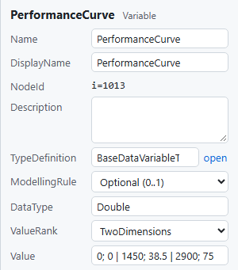

### Structures

When the DataType is a structure or a union, the value is edited field by
field in a section named after the DataType, such as **Value
(PumpSettingsDataType)**. This holds for the ValueRanks Scalar (one
structure) and OneDimension (an array of them). "No value yet." means the
variable has none.

- A field of a built-in type is a text field; an array as elements separated
  by semicolons.
- A field of an enumeration is a list of its values, "Name (number)".
- A field that is a structure shows its own fields below its name; deeper
  levels start folded.
- An array of structures has **Add item**, and **Remove** for each item.
- An optional field that is left out shows "optional, not set" with a
  checkbox; check it to set the field, uncheck the box before its name to
  leave it out again.
- A union shows **set field**, the list of its fields to choose the one that
  is set, and then that field.

**Apply** writes the value as one step, **Discard** drops the changes, and
**Remove value** removes the value.

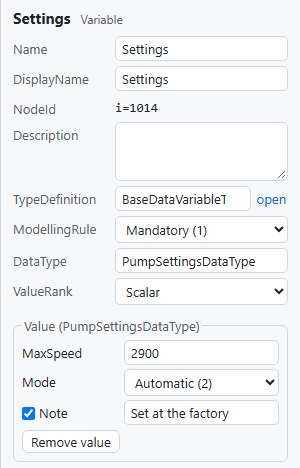

### Values the panel does not edit

A value the panel cannot edit is kept as it was read. The panel then says
"A structured value; kept as it was read.", or the Value field is greyed
with "values of this DataType are not edited here" (a DataType that is no
built-in type and no structure the panel can edit) or "choose a DataType
first". See [Limits](#limits).

## Methods and arguments

Add a method with **Add child** (**Method (HasComponent)**) or **M** in the
context pad. Its panel has two sections, **Input arguments** and **Output
arguments**. **+ Argument** adds a row: the name, the DataType and one of
**Scalar**, **Array**, **Any** and **Array (n dims)**; **×** removes the
row. **Apply** writes the arguments as the property InputArguments or
OutputArguments, creating or removing the property as needed; **Discard**
drops the changes. Every argument needs a name, and two arguments of one
list cannot have the same one.

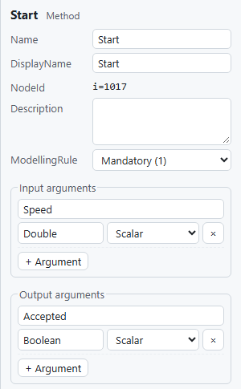

A method of a state machine type can cause a transition, see [State
machines](#state-machines).

## References

The children a node holds by HasComponent and HasProperty come from **Add
child**. Every other reference is drawn on the canvas or added in the
panel.

On the canvas, select the node the reference starts at, click **→** in its
context pad (or drag it) and click the node it leads to. A dialog asks for
the ReferenceType, offering the last one used (Organizes at first) and
suggesting the concrete ReferenceTypes of all loaded models. A reference
starts at a node of your model and may lead to any node on the diagram.

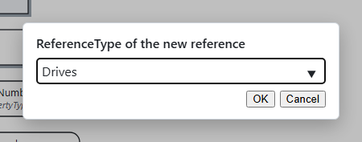

In the panel, the section **References** lists the node's references
besides the hierarchy, the type system and the ModellingRule, or says "None
besides the hierarchy." **×** removes one. To add one, type the
ReferenceType into the field **ReferenceType …**, choose the node it leads
to from **Target …** (the nodes of your model, by their path, such as
`PumpType/Impeller`) and click **Add**.

The diagram draws such references on rails to the right of the shapes,
with their name. In the example, `Motor` drives `Impeller`.

## State machines

The modeler writes finite state machines as OPC 10000-5 describes them and
as the base model writes its own.

### A machine type

**+ machine** in the group ObjectTypes adds a state machine type, a subtype
of FiniteStateMachineType. Its panel has the section **State machine**,
which says what comes first: "No states yet. A machine needs its states
first, then the transitions between them."

- **States**: type a name into **New state** and click **Add state** (or
  press Enter). The states are numbered 1, 2, 3 … as they are added; the
  table shows them with their number.
- **Transitions**: type a name into **New transition**, choose its states
  in **from …** and **to …**, and optionally a method of the machine type in
  **caused by …**, then click **Add transition**. The list shows each
  transition with its states and its cause, such as `Idle → Running /
  Start()`. Transitions are numbered as well.
- A method to cause a transition is added first, with **Add child** on the
  machine type.

Click the name of a state or transition to show it in the panel; **×**
removes it. The ends of an existing transition have no field of their own:
remove the transition and add it again.


### Sub-state machines

A state can hold a machine of its own. In the row **Machine of**, choose the
state and then the machine type; the list offers the finite state machine
types of your model and of the loaded models besides the base model, except
this type and its subtypes. The modeler adds a Mandatory component
`<State>StateMachine` of that type, which the state refers to with
HasSubStateMachine. Another machine type replaces it; **(none)** removes it.

### The state chart

**State chart**, below the lists, draws the machine: the states on a circle,
the transitions as arrows with their name and cause. A state with a machine
of its own has a second outline and the type of its machine below it.

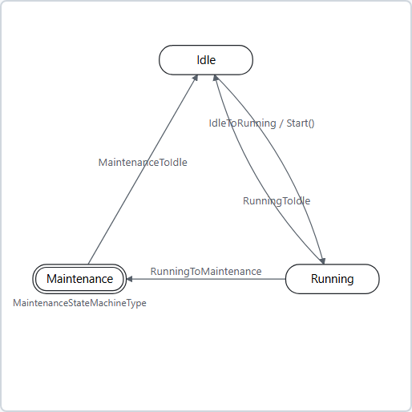

## Instances

### Creating an instance

Every ObjectType and VariableType has the section **Create instance**, also
the types of loaded models (FolderType, a DI type and so on).

- **Optional children to include:** a checkbox for each Optional
  declaration, by its path (such as `Motor/Temperature` for a declaration
  below another).
- **Place**: where the instance goes: the Objects folder, the nodes loaded
  models put there for others to fill (such as **DeviceSet (DI)** once DI
  is loaded), or an instance of your model. A node of another model stays
  as it is; the new instance alone holds the reference.
- **Name of the instance**, then **Create**. For an abstract type **Create**
  stays disabled ("Abstract types have no instances.").

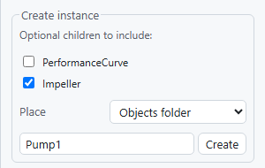

The instance gets every Mandatory declaration of the type and its
supertypes, the Optional ones you checked, and no placeholders; each with
its TypeDefinition, DataType and value. References between the declarations
become references between the new nodes. The children of an instance have
no ModellingRule.

### Working with instances

The panel shows the new instance. An instance is edited like any node: its
values, its TypeDefinition, its references. **Add child** adds children to
it, with a name of your choice. To fill a placeholder of the type, add a
child of the same NodeClass and give it the placeholder's TypeDefinition or
a subtype of it.

An instance does not follow later changes of its type. The checks report
what it lacks: in the example, `FlowRate` was added to `PumpType` after
`Pump1` was created, and rule M022 reports that `Pump1` has no `FlowRate`.

## Checks and findings

The modeler checks the model against OPC 10000-3 after every change. The
**Checks** button in the toolbar counts the findings, "Checks: 1 error(s),
0 warning(s)", and is outlined while there are errors. Click it to show or
hide the list of findings above the status line (the picture in [The
screen](#the-screen) shows it open).

Each finding has its severity, its rule and a sentence with the name of the
node. Hovering over the rule shows what it checks. Click a finding, or
select it and press Enter: the panel shows its node, and when the node
belongs to a type, the canvas shows that type.

Findings are advice: a model with findings can still be saved. Should the
checks themselves fail, the button says **Checks failed** and the list says
why.

| Rule | Severity | What it finds |
|---|---|---|
| M001 | error | A reference points to a node or reference type that is neither in the model nor in a model it requires. |
| M002 | error | Two children of one node have the same BrowseName. |
| M003 | error | An Object or Variable has no TypeDefinition. |
| M004 | warning | A Variable or VariableType has no DataType. |
| M005 | error | A type has no supertype. |
| M006 | warning | An instance declaration below a type has no ModellingRule. |
| M007 | error | An instance (no ModellingRule) is typed by an abstract type. |
| M008 | warning | A non-symmetric ReferenceType has no InverseName. |
| M009 | warning | The BrowseName is in another namespace than the NodeId. |
| M010 | warning | A structure has no "Default Binary" encoding, so servers cannot encode its values. |
| M011 | warning | A structure or enumeration has no fields, so clients cannot interpret its values. |
| M012 | error | The model declares a node whose NodeId belongs to another namespace. |
| M013 | error | ValueRank and ArrayDimensions do not agree. |
| M014 | error or warning | An argument of a method names a DataType the model does not know. |
| M015 | warning | A placeholder is not named in angle brackets, or a name in angle brackets is no placeholder. |
| M016 | error or warning | A node held by HasProperty is not a Variable of PropertyType. |
| M017 | error | Two fields of a DataType have the same name, or two values the same number. |
| M018 | error | A symmetric ReferenceType has an InverseName. |
| M019 | warning | No reference at all leads to a node: it is part of no type and no hierarchy. |
| M020 | error | A transition of a state machine does not name both of its ends. |
| M021 | error or warning | A state or transition has no number, or two of them share one. |
| M022 | error | An instance is missing a child its type declares as Mandatory. |
| M023 | error | An instance fills none of a MandatoryPlaceholder its type declares. |
| M024 | error | A value does not fit the DataType or ValueRank of its node. |
| M025 | error | A variable or a field names a DataType that is unknown or no DataType. |

## Undo and redo

**Undo** and **Redo** in the toolbar, or Ctrl+Z and Ctrl+Y (Cmd on a Mac),
take changes back and bring them again. While the cursor is in a text field
or a list, the keys belong to that field.

Every change is one step: a field, a child, a deletion. So is every
**Apply** of a section and every file of variables from CSV, however much
they change. The modeler keeps the last 100 steps of a model; opening or
starting a model begins anew. Moving shapes, **Reset layout**, loading a
further model and saving are no steps.

## Saving and what is kept

**Save NodeSet** saves the model as a NodeSet2 file, which the browser
downloads. The file is named after the namespace: `http://example.org/Pump/`
becomes `example.org.Pump.NodeSet2.xml`.

What the file holds:

- **What was read**: everything the modeler read is written back as it
  was, also what it does not edit (values, definitions, extensions,
  attributes).
- **Diagram positions**: where you placed shapes, in the NodeSet's own
  `Extensions` (OPC 10000-6 Annex F). Other tools ignore them; the modeler
  finds them again when it opens the file.
- **RequiredModels**: every model whose nodes your model uses is declared
  as a RequiredModel, with the version and publication date of the loaded
  model. A model that is loaded but not used is not declared; in the
  example DI is loaded, and the saved file requires the base model only.
  RequiredModels the file already declared stay.
- **Version and publication date** as set in the [model
  panel](#the-model-panel).

Saving ends the star of **Save NodeSet \*** and removes the backup of the
model (next chapter). Closing or reloading the page with unsaved changes
makes the browser ask first.

## The backup of unsaved work

On a page of its own, the modeler keeps unsaved work in the browser (in its
IndexedDB): about one and a half seconds after you stop editing, and when
the page is closed, as far as the browser lets it. The NodeSet files you
loaded as further models are kept with it.

At the next start, the page offers what it kept:

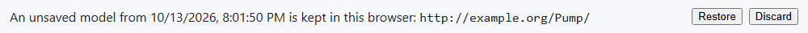

**Restore** opens the model as it was, still unsaved; **Discard** forgets
it. Of several, the newest is offered.

- The backup goes as soon as the model is saved.
- A page never offers the backup of another page that is still open, such
  as a second tab.
- A backup that does not open stays offered, and the status line says why.
- If the browser refuses to keep the backup, the status line says so ("The
  browser keeps no backup of the model: …").
- The backup lives in this browser on this computer; another browser does
  not see it.

Inside a host such as AMLOpcUa there is no backup in the browser; the host
keeps the model.

## Language

The interface is in English or German, as the first language set in the
browser says: German when it is German, English otherwise. To switch,
change the language of the browser and reload the page. Inside the
AutomationML Editor the language of Windows decides.

OPC UA terms stay as the specification names them in both languages
(NodeSet, BrowseName, ModellingRule, ObjectType …). The messages of the
modeler's core, such as refused changes and findings, appear in the
language of the interface too.

## Embedding

The AutomationML Editor plugin [AMLOpcUa](https://github.com/hsu-aut/AMLOpcUa)
hosts the modeler in its Modeler tab. There it differs from the page on its
own:

- **New model…**, **Open NodeSet…** and **Open DI sample** are missing: the
  plugin's own toolbar opens and starts models, because it finds the
  NodeSets a model requires in its folders.
- **Apply to document** imports the model into the AutomationML document.
- **Save NodeSet** opens the plugin's save dialog instead of a download.
- The page stays editable while the plugin imports or saves. What you change
  meanwhile is not in what the plugin took, so **Save NodeSet** keeps its
  `*` and the status line says so, provided the plugin reports which change
  it took (plugins before NodeSet.js 0.2.1 do not; with them the model counts
  as saved once the plugin answers).
- There is no backup in the browser, and the page follows the editor's
  light or dark theme.

How the plugin opens, applies and saves models is described in
[AMLOpcUa docs/modeler.md](https://github.com/hsu-aut/AMLOpcUa/blob/main/docs/modeler.md).
For embedding the modeler in an application of your own, or for building
NodeSets from a script, see "As a library" in the [README](../README.md).

## Limits

What the modeler does not edit, or edits only in part:

- **One model.** It edits one NodeSet at a time, and in it the first model
  the file declares; new nodes go to its namespace. The namespace URI of the
  model cannot be changed.
- **Other models** are read only. To change a node of a loaded model, open
  its NodeSet.
- **NodeIds** are assigned by the modeler, numbers from 1000 upward, and
  cannot be changed.
- **Attributes without a field** in the panel, such as the DisplayName apart
  from the name, texts in further locales, AccessLevel, ArrayDimensions and
  SymbolicName, are kept as they were read.
- **DataType fields**: their descriptions, the descriptions of enumeration
  values, and what else a field carries (MaxStringLength, ArrayDimensions)
  are kept but have no field in the panel.
- **Values**: values of built-in types such as NodeId, QualifiedName or
  StatusCode, matrices of three or more dimensions, structures with a field
  that allows subtypes, and structure values of other ValueRanks than
  Scalar and OneDimension are kept, not edited.
- **Transitions**: the states and cause of an existing transition have no
  field; remove the transition and add it again.
- **Views** are neither created nor edited.
- **The diagram** shows a type's own declarations, three levels deep and
  at most 200 shapes, and not the ones it inherits. It cannot be exported
  as a picture.
- **The list of instances** shows the instances the Objects folder
  organizes or a node of a loaded model holds. An instance placed below
  another instance shows in that instance's diagram, not in the list.
- **Instances** do not follow later changes of their type.
- **Undo** keeps the last 100 steps; moving shapes is not one of them.
